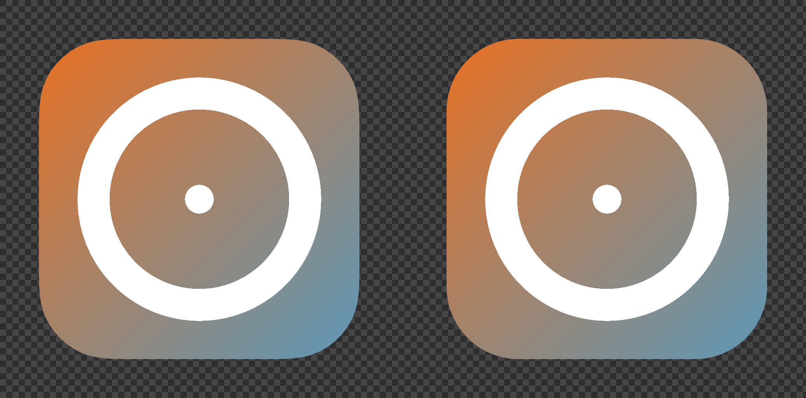

# dsh-any-icon

一个 [DeepSeek Harness (dsh)](https://github.com/deepseek-ai/deepseek-harness) 插件：**上传图片 → 裁成 1:1 图标 → 设为 dsh 桌面端自己的应用图标**。

访达 / 应用程序 / Dock **立即同步更新**（1–3 秒），不重启 dsh、不打断运行中的任务；原始图标字节级备份，可一键还原。全部流程在 dsh 设置页的「图标工坊」（Icon Studio）面板完成。

> **验证范围**：原有深度实测基于 **macOS 26 + dsh 桌面版 0.2.0-rc.2**。现已声明兼容 dsh `>=0.2.1-rc.2 <0.3.0-0`，覆盖本机桌面版 `0.2.1-rc.2` 及 0.2.1 稳定版；本次适配依据 0.2.1 的兼容规则和接口变更记录完成，尚未重新安装插件进行运行验证。**Windows 尚未做深度验证**，行为不作保证（App 图标替换本身也仅实现了 macOS）。

## 功能一览

### 图标工坊

- **上传**：PNG / JPG / WebP，单图 ≤ 20MB，建议边长 ≥ 1024px
- **裁剪器**：强制 1:1；拖动定位、滚轮 / 滑杆缩放、方向键微调（Shift 加速）、90° 旋转、重置
- **输出规格**：
  - 「标准 1:1」——方形图标，默认
  - 「macOS Dock」——输出 1024×1024 的 macOS 应用图标文档：824×824 图形 + 四周 100px 透明边距，图形按**连续曲率圆角（squircle）**遮罩（macOS 的应用图标圆角由开发者自绘，系统不会自动加）。做 App 图标推荐选它

  
- **图标库**：删除 / 下载多尺寸 PNG 套装（macOS Dock 图标含 1024px，其余 512/256/128/64）
- **备份**：导出 / 导入 JSON，可跨浏览器迁移
- 中英双语（跟随界面语言），存储满额友好提示

### dsh App 图标

- 工坊底部「dsh 图标」区：从图库选一个图标 → 「设为 dsh 图标」/「恢复原始图标」
- 点一下立即生效：访达（应用程序文件夹）、应用程序 / 启动台视图、Dock 三处同一瞬间更新——不重启 dsh、不重启 Dock/Finder、不打断正在运行的任务
- 状态面板：目标路径、实时图标 / 原生图标 / 当前签名 / 应用版本 / 是否运行
- 原始图标 4 个文件字节级备份在 `~/.dsh/any-icon/`，「恢复原始图标」后原始 Developer ID 签名重新有效

## 使用说明

1. **打开工坊**：dsh 设置 → 图标工坊。
2. **上传并裁剪**：点「上传图片」选图，拖动 / 缩放把想保留的画面摆进裁剪窗。要做 App 图标，把输出规格切到「macOS Dock」；点「保存图标」入图库。
3. **设为 dsh 图标**：在「dsh 图标」区从图库选中图标 → 「设为 dsh 图标」→ 确认。首次使用 macOS 会弹出「App 管理」权限请求，请允许（或在 系统设置 → 隐私与安全性 → App 管理 中手动开启）。
4. **还原与迁移**：随时「恢复原始图标」还原 dsh 图标；「导出备份」把图库存为 JSON，在别的浏览器里「导入备份」即可迁移。

## 安装

### Web / CLI（本地开发或体验）

```bash
# 1) 以 link 依赖装入 web profile
cd ~/.dsh/profiles/web
# package.json: dependencies 增加 "dsh-any-icon": "link:<本仓库绝对路径>"
#               dsh.profile.bundles 数组增加 "dsh-any-icon"
ln -sfn <本仓库绝对路径> node_modules/dsh-any-icon

# 2) cordis.patch.yml 追加：
# - insert:
#     - id: any-icon
#       name: dsh-any-icon

# 3) 启动
dsh web --no-open
```

### 桌面版（dsh Desktop）

桌面 profile 由桌面应用独占管理（CLI 写入会被拒绝）。请在桌面版的 **插件管理** 中安装本插件（发布到 npm / GitHub 后可直接安装；发布前可用 `dsh plugin --profile web add link:...` 的方式在 web 端体验）。

> 兼容性：`package.json` 的 `engines.dsh` 声明支持 `>=0.2.1-rc.2 <0.3.0-0`。当前本机桌面版为 0.2.1-rc.2；插件对接的设置 Slot 与 Typert 远程服务接口无需迁移。本次改动尚未重新安装插件做桌面运行验证。**Windows 未做深度验证**；dsh 处于开发者预览期，Slot 契约可能变化。

### 卸载

删除上述修改（`package.json` 依赖与 bundles、`node_modules` 链接、`cordis.patch.yml` 的 insert 段），或从备份恢复：同目录下留有 `package.json.bak-anyicon` 与 `cordis.patch.yml.bak-anyicon`。浏览器内的图标数据在 `localStorage` 的 `dsh-any-icon.*` 键下，可在工坊中导出备份后清除。

## 技术实现（简）

双半体插件：Node.js **Host**（`lib/index.js`，提供 `anyIcon` 远程服务）+ 浏览器 **Client**（`src/client/main.js`，图标工坊 UI），经 dsh 的 Typert 远程服务桥接，契约单源在 `shared/bridge.js`（zod 双端校验）。客户端图标数据存 localStorage；UI 经 dsh Slot 注入，Slot 缺失时安静降级。

App 图标「立即生效」采用**双层机制**：替换应用包内 `icon.icns`（ad-hoc 重签名 + 字节级备份，持久层）+ 写入 Finder 自定义图标（访达 / 应用程序 / Dock 优先读的实时层），再按实测顺序刷新 iconservices 与 Dock 图标缓存。macOS Dock 规格的遮罩为 G2 连续曲率圆角矩形（参数经 macOS 26 系统渲染图标实测校准）。

```
shared/bridge.js           Client↔Host 契约（zod + 调用描述符）
shared/squircle.js         macOS Dock 遮罩算法（纯几何）
lib/index.js               Host：AnyIconService
src/client/main.js         Client：工坊 / 裁剪器 UI
client/client.js           构建产物（已提交，安装无需构建）
tools/build-client.mjs     构建脚本
tools/verify-squircle.mjs  遮罩几何断言 + 预览渲染
```

## 变更记录

> 历史分支与早期文档中的 v2.0 / v2.1 / v2.2 为内部叫法；自 v0.3.0 起使用语义化版本。

- **v0.3.1**：新增「macOS Dock」裁剪输出规格（1024×1024 画布 + squircle 遮罩）；ICNS 补齐 1024px 档；移除会话图标功能，插件聚焦 dsh App 图标
- **v0.3.0**：App 图标改为「立即生效」——双层图标 + 图标缓存刷新，不再重启 dsh / Dock / Finder；字节级备份 + 一键还原
- 更早（会话图标 v1 等）的变更：见 Git 历史

## 路线图

- **v0.4+**：图标库 Host 侧存储（跨浏览器同步）；`set_app_icon` 模型工具（对话式换图标）
- **待定**：Windows .exe 资源级图标（需 Resource Hacker 类工具链）；更多平台目录扫描

## 已知限制

- **平台验证范围**：仅在 **macOS 深度验证**（开发、实测、签名与还原流程）；**Windows 未做深度验证**，行为不作保证。App 图标替换本身仅实现 macOS。
- **App 图标**：dsh 自身的「关于」面板在下次启动时才更新；dsh 自动更新会整体替换应用包并还原图标，重新应用即可。需要 macOS「App 管理」权限，被拒时界面会给出授权指引。
- 「恢复原始图标」还原的是 any-icon 首次接管前的备份；若应用此前已有第三方自定义图标，插件不会覆盖并明确报错。
- **macOS Dock 规格**：建议原图边长 ≥ 1024px；自绘 squircle 与系统实际遮罩有 ≤2.5% 的形状系统差（Dock 显示尺寸下不可见）。
- 图标库上限 30 个；单图超 20MB 拒绝上传；图标数据不跨浏览器 / 设备自动同步。

## License

MIT
